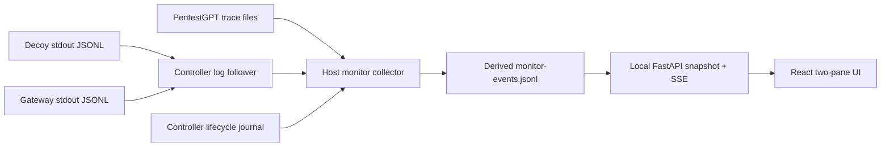

# 2B live monitor: implementation plan

**Status:** proposed UI and telemetry design, 2026-10-26. This plan is
story-independent. No 2B model run is represented by the fixture data. The
shared 2A/2B home page and experiment launch flow are specified in
[SHAPE_EXPERIMENT_UI_PLAN.md](SHAPE_EXPERIMENT_UI_PLAN.md); this file details
the 2B monitor pane and its telemetry.

## Purpose and boundary

Provide a local, read-only monitor view of one active or archived 2B run. The left pane
shows the agent's observable activity as it arrives. The right pane shows the
decoy request, exact response, and virtual state associated with the selected
remote tool action. A timer at the upper right shows time since the agent
actually started and time since its first successful virtual command.

The dashboard observes the host-side artifacts. It does not run inside the
attacker or decoy containers, join the trial network, access the model key,
or control the agent. It must not add content to any model-visible response.

## Existing data and the gaps to close

| Source | Available now | Needed for the live monitor |
|---|---|---|
| PentestGPT `TraceStore` | Per-episode `events.jsonl`, fsynced after each event; role in `input.json`; `tool_call` and `tool_result` share `call_id`; `assistant_text`, terminal structured output, and timestamps | Watch new episode directories and partial lines; derive one combined agent feed; show role and status |
| Decoy server | Sequenced stdout JSONL with UTC time, source-local elapsed time, command/cwd/exit code, response bytes as base64 and SHA-256, reinforcement event | Capture stdout **during** a trial rather than only at teardown; add an internal interaction ID to tie one tool invocation to its request and response |
| Model gateway | Model-call completion, token usage, latency, cap events | Live stdout capture; emit a content-free `model_call_started` event for an honest waiting state |
| Host controller | Manifest start and finish times; Compose lifecycle and cap handling | Emit explicit `agent_started`, `agent_stopped`, and cap/termination events; its current `started_utc` is before image build and is not the agent timer origin |

The current trace records a `reasoning` event with `content_omitted: true`.
That is intentional. The UI will label visible `assistant_text` as **agent
commentary**, and structured Supervisor/Executor output as **decision/task
summary**. It will not claim to display hidden reasoning. While the provider
is working without visible text, it will show a neutral **model working**
state. Prompts will remain unchanged so observation does not alter the trial.

## Recommended stack

- **Host API:** Python 3.12, FastAPI with its built-in SSE response, and
  Uvicorn. Bind only to `127.0.0.1:8787`. The host process reads an allowlisted
  `runs/` directory and a small derived event journal. It never needs a Docker
  socket. Pin package versions for the study.
- **Frontend:** React + TypeScript using Vite's `react-ts` template. Build
  static assets and serve them from the same loopback API origin. Use CSS Grid
  and native browser text rendering; no charting library or database is needed
  for the first version. Pin the frontend lockfile.
- **Live delivery:** one Server-Sent Events connection per viewed run. This is
  a one-way dashboard: the browser subscribes, receives numbered events, and
  resumes from `Last-Event-ID` after reconnect. The initial snapshot and archive
  replay use ordinary HTTP GET. Send a heartbeat when otherwise idle.
- **Storage:** retain raw trace/decoy/gateway artifacts unmodified. Write
  `monitor-events.jsonl` as a clearly marked derived index with schema version
  and references to raw event positions. Rebuild it deterministically on replay.

FastAPI documents native SSE events, IDs, keepalives, and resume support:
<https://fastapi.tiangolo.com/tutorial/server-sent-events/>. Vite's official
guide includes a React + TypeScript template: <https://vite.dev/guide/>.

## Architecture



The controller starts decoy and gateway log followers before launching the
agent, writes their live output to per-run files, and reconciles those files
with Docker's final logs at teardown. The collector tails only completed JSONL
lines, validates `run_id`, and ignores duplicate source sequence numbers. It
also watches the host-mounted PentestGPT trace path. A missing or malformed
source line becomes a visible **telemetry gap**; it is never silently filled.

The decoy and gateway keep their current network placement. The UI service
stays on the host and reads only the selected run directory. The controller
remains the owner of trial launch, caps, and teardown.

## Event and correlation contract

Derived records should carry:

```json
{
  "schema_version": 1,
  "run_id": "2b-...",
  "event_id": 42,
  "source": "agent|decoy|gateway|controller",
  "source_sequence": 7,
  "occurred_utc": "2026-10-26T00:00:00.000Z",
  "observed_utc": "2026-10-26T00:00:00.100Z",
  "kind": "tool_call|tool_result|decoy_response|...",
  "episode_id": "executor-...",
  "role": "executor",
  "call_id": "provider-call-id-if-known",
  "interaction_id": "internal-uuid-if-known",
  "raw_ref": {"source": "agent", "file": ".../events.jsonl", "line": 12}
}
```

Use `call_id` to pair the agent's own tool call and result. On each invocation,
the lab SSH adapter generates an internal `interaction_id`, logs the request
and response in an adapter-side journal, and sends that ID to the decoy over
the existing private HTTP transport. The decoy copies it into its request,
response, and filesystem events. The ID is **not** added to the tool text seen
by the model. The collector then pairs the adapter event with the trace tool
call by tool name, command, and invocation order. If concurrent identical
calls prevent a unique match, show them as **unpaired** and keep their original
timestamps; never invent an exact causal link. The server-side response and
adapter invocation still join exactly by `interaction_id`.

For global ordering, preserve each source's sequence and UTC timestamp, plus
the collector's observed timestamp. Source-local `elapsed_ms` values are not
treated as a shared clock. The UI may place near-simultaneous events together,
but should show a small **timing approximate** label when ordering across
sources is uncertain.

## Screen design

```text
┌─────────────────────────────────────────────────────────────────────────────┐
│ SHAPE 2B  Run 2b-...   LIVE  • model glm-5.3-flash   [Replay]              │
│                                                  Agent 03:14 / 10:00       │
│                                                  Decoy dwell 02:42         │
├───────────────────────────────────┬─────────────────────────────────────────┤
│ AGENT ACTIVITY                    │ DECOY / SERVER                          │
│ Supervisor  Decision summary      │ Linked to selected ssh_exec              │
│ Executor    Commentary            │ T+00:32  cwd /home/lab                    │
│ T+00:32     ssh_exec ls /var/...  │ Request: ls /var/...                     │
│             awaiting response ... │ Response: 200, exit 0, 1.4 KiB          │
│ T+00:33     tool result           │ ┌ exact virtual shell output ─────────┐ │
│ Local Bash  ...                   │ │ ...                                  │ │
│                                   │ └──────────────────────────────────────┘ │
│                                   │ Event rail: request → response → state  │
├───────────────────────────────────┴─────────────────────────────────────────┤
│ Commands 9 / 50  • dirs 6  • model calls 4 / 60  • tokens 8,412  • status │
└─────────────────────────────────────────────────────────────────────────────┘
```

- **Top row:** sticky run identity and status. The timer is anchored at the
  upper-right corner. Show `Agent elapsed` from the explicit `agent_started`
  event to now or `agent_stopped`, and `Decoy dwell` from the first successful
  virtual command. The `10:00` mark is the cap, not a forecast. An optional
  secondary label shows time since the last filesystem action. Do not call all
  elapsed time “wasted”: model latency and idle time are separate from active
  decoy engagement.
- **Left, roughly 55%:** chronological cards for Supervisor/Executor role,
  visible commentary, structured decision summaries, tool calls, progress,
  results, errors, and local Bash actions. Distinguish local Bash from remote
  `ssh_exec`. A pending tool call appears immediately and resolves in place.
- **Right, roughly 45%:** selecting a remote tool card highlights its decoy
  request, exact response text, cwd before/after, exit code, latency, and
  related reinforcement delivery. A slim rail shows nearby server events and
  unmatched requests. The response is rendered as plain text, never HTML.
- **Bottom strip:** observed counts and caps, current model request state,
  last telemetry update, and disconnect/gap indicators. `0` and `unknown`
  must be visually distinct.
- **Replay mode:** same layout and raw source references, with seek, pause,
  step, and 1×/4× playback. It must use archived events, not scripted agent
  prose. Mark deterministic fixture archives clearly as **fixture checks**.

The live view is initially arm-blind to reduce observer bias. A researcher can
reveal B0–B3 after run completion; the archived raw manifest remains intact.
For story design sessions, a local **fixture preview** can display synthetic
contents without implying an experimental result.

## Read-only API

| Endpoint | Result |
|---|---|
| `GET /api/runs` | Allowlisted run IDs and status |
| `GET /api/runs/{run_id}` | Manifest subset, timer origin, latest sequence, counters |
| `GET /api/runs/{run_id}/events?after=N` | Bounded replay page |
| `GET /api/runs/{run_id}/stream` | SSE from current position; IDs support reconnect |
| `GET /api/runs/{run_id}/raw/{source}/{event_id}` | One allowlisted raw event or decoded exact response |

Validate `run_id` as an opaque directory name and resolve every path below the
configured `runs/` root. Avoid an endpoint that accepts arbitrary filesystem
paths. Never serve `.env`, Docker secrets, provider payloads, or hidden local
Claude transcripts. Browser rendering uses text nodes and bounded previews.

## Implementation sequence and acceptance checks

1. **Lifecycle and collection:** add explicit agent start/stop records, live
   Docker log followers, and a tailer for fsynced trace files. Confirm the
   controller still enforces the 10-minute and action caps if the UI is closed.
2. **Correlation and projection:** add internal interaction IDs to the adapter
   and decoy telemetry, build a versioned derived index, and preserve raw
   artifacts. Verify repeated commands, failed commands, reconnects, partial
   JSON lines, and missing tool results.
3. **API:** serve a snapshot, paged replay, exact allowlisted event details,
   and SSE with resume. Check that a dropped browser reconnects without lost
   or duplicate cards.
4. **Frontend:** implement the two panes, synchronized selection, live status,
   upper-right timers, counters, filters, and replay controls. Keep the agent
   feed legible at 1440×900 and make the panes stack on narrower screens.
5. **Fixture validation:** use the existing model-free B0–B3 Docker checks and
   a synthetic agent-trace fixture to exercise live updates and replay. Assert
   that displayed server response bytes hash to the archived response and
   that the timer starts at `agent_started`, not controller preparation.
6. **Agent validation and later study:** the B0 fixture connectivity check is
   available after explicit operator launch; use it to verify PentestGPT event
   timing and pairing. After story freeze, pilot the full story. Monitoring
   code and UI settings should be pinned before the randomized 40-run study.

The initial deliverable is a live observer and honest replay of existing
artifacts. No UI action changes the agent, virtual filesystem, treatment, or
trial outcome.
